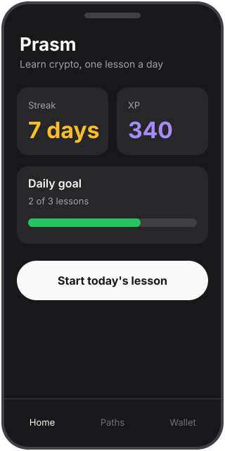
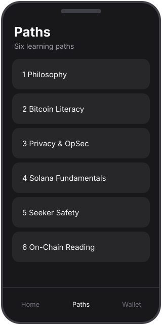
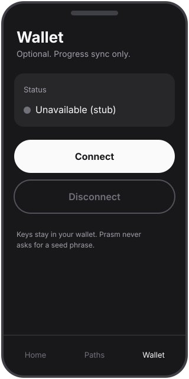
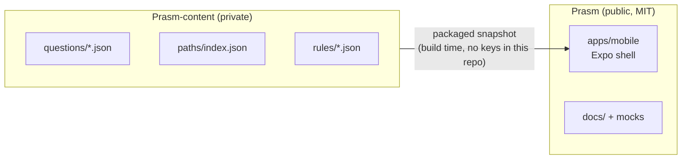
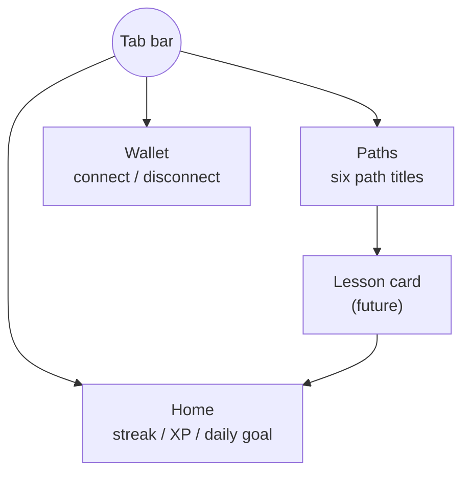
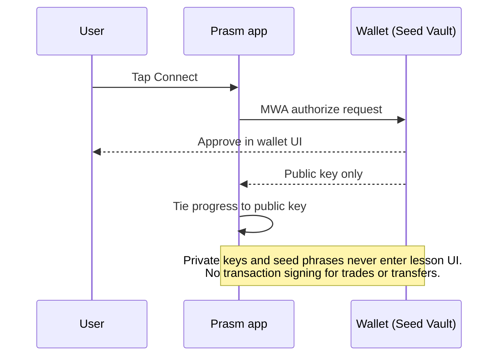

# Prasm

**Bite-sized crypto education for Solana Mobile Seeker.** Daily lessons, streaks, and XP - like a language app, but for understanding money, privacy, and the chain you hold in your pocket.

> **Status: early scaffold.** The Expo shell and screens exist; the live curriculum has not shipped. Prasm is a learning app only - no trading, no swaps, no custody, ever.

License: [MIT](LICENSE)

---

## The story

Most people get their first Solana phone and immediately face words like *seed phrase*, *account*, and *signature* - usually from a stranger in a group chat. Prasm exists so the first teacher is a calm, honest one.

Open the app, do one three-minute lesson, keep your streak alive. Over a few weeks you move from *why does any of this exist* to *I can read a transaction in an explorer and know what it did*. Connecting a wallet is optional and only syncs progress; your keys stay in your wallet, and Prasm never asks for a seed phrase.

- **Daily lessons** - short multiple-choice cards with plain-English explanations
- **Streaks** - come back tomorrow, keep the flame going
- **XP and daily goals** - small, steady rewards for showing up
- **Optional wallet connect** - Mobile Wallet Adapter (MWA) for progress sync only

## Mockups

| Home | Paths | Wallet |
| --- | --- | --- |
|  |  |  |

Mockups are illustrative SVGs, not screenshots of a shipped build.

## Learning paths

Six paths, ordered from foundations to hands-on literacy. Titles only here - lesson content and answer keys live in the private content pack.

| # | Path | What you walk away with |
| --- | --- | --- |
| 1 | **Philosophy** | Why open, permissionless money and cryptography matter |
| 2 | **Bitcoin Literacy** | What money is and how Bitcoin approached it |
| 3 | **Privacy & OpSec** | Habits that protect you and your keys |
| 4 | **Solana Fundamentals** | Accounts, keys, and transactions in plain language |
| 5 | **Seeker Safety** | Using a crypto phone without getting phished |
| 6 | **On-Chain Reading** | Reading an explorer with confidence (read-only) |

The path structure was inspired by the general shape of community curricula such as cypherpunk-code; Prasm is a fresh codebase with no code reused.

## Architecture

### Public app vs private content



### App screens



### Wallet boundary: connect only



## Repository layout

```
Prasm/
  apps/mobile/     Expo (React Native, TypeScript) shell
  docs/mocks/      SVG mockups used in this README
  LICENSE          MIT
  README.md
```

## Principles

1. **Education, not finance.** No trading, swaps, price feeds, or custody features.
2. **Keys stay home.** Wallet connect is optional and identity-only.
3. **Honest copy.** Plain English; no hype, no promises of returns.
4. **Small daily habit.** A lesson should fit in a coffee break.
5. **English only** across code, comments, docs, commits, and UI strings.

## Run the mobile app

```bash
cd apps/mobile
npm install
npx expo install --fix
npx expo start
```

The scaffold was hand-written, so the first local install generates the lockfile and aligns Expo package versions. See [apps/mobile/README.md](apps/mobile/README.md).

## Contributing

- Issues and PRs are welcome: UI polish, accessibility, MWA integration, tests.
- Keep everything in English and keep the no-trading / no-custody line.
- Never commit lesson answer keys here - curriculum lives in the private sibling repo.
- Small focused PRs with a clear description beat large ones.

## This repo vs Prasm-content

This README is for users and contributors. Curriculum authoring (question bank, XP rules, path data) happens in a private sibling repository, `Prasm-content`, and reaches the app only as a packaged snapshot.

## License

MIT - see [LICENSE](LICENSE).
